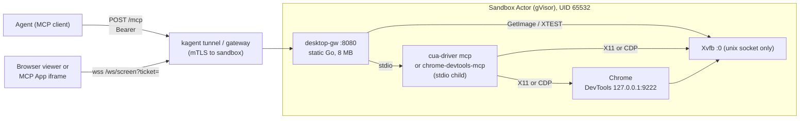

# ADR: MCP control and web screen streaming for desktop sandboxes

Status: proposed (prototype validated on runc and gVisor). Date: 2026-10-31.

## Context

The RustDesk prototype (`../rustdesk-proto`) gives a person a remote desktop
inside a kagent sandbox. It has three costs:

- It needs a native client.
- It needs two forwarded WebSocket ports.
- It is AGPL-3.0.

The new requirements are:

1. An **agent** drives the desktop through **MCP**.
2. A **person** watches the same screen in a **web page**, and sometimes takes
   control.
3. The stream travels over **WebSocket**. mTLS is optional, and no VNC or
   RustDesk port is exposed.
4. The viewer can be embedded in an MCP host as an **MCP App** (SEP-1865,
   `text/html;profile=mcp-app`).

Selection criteria, in priority order:

1. Small runtime.
2. Static binary.
3. Minimal dependencies.
4. Permissive license.
5. One forwarded port.

## Decision

Add one in-sandbox gateway, **`desktop-gw`**. It is a static Go binary with two
dependencies and is the sandbox's only listener (`:8080`). It serves:

| Path | Purpose |
| --- | --- |
| `GET /` | HTML viewer (canvas plus WebSocket, 210 lines, no framework). |
| `POST /ticket` | Exchanges the Bearer token for a single-use, 60 s viewer ticket. |
| `GET /ws/screen` | X11 frames as JPEG over WebSocket. Optional XTEST input when the ticket allows control. |
| `/mcp` | MCP Streamable HTTP bridged to one stdio MCP server per session. Adds the `desktop_view` tool and the `ui://desktop-gw/viewer` MCP App resource. |

The MCP server behind `/mcp` is a build-time choice:

| Variant | MCP server | Scope | When to use it |
| --- | --- | --- | --- |
| `cua` | `cua-driver` 0.38.0 (MIT) | Whole desktop: windows, mouse, keyboard, screenshots | Default. Smallest addition. |
| `cdm` | `chrome-devtools-mcp` 1.12.0 (Apache-2.0) | Chrome only, through CDP | Browser-only agents that need DOM-level tools. |

The MCP server and Chrome DevTools listen only on stdio or loopback. People get
the screen from `desktop-gw`, not from the MCP server.

## Options considered

### Screen stream and client

| Option | License | Runtime added to the sandbox | Client | Ports | Input | MCP App | Verdict |
| --- | --- | --- | --- | --- | --- | --- | --- |
| **desktop-gw** (this demo) | ours; deps ISC + BSD-3 | 8 MB static binary, 9 MB RSS idle, 35–55 MB streaming | any browser, 10 KB HTML | 1 | XTEST, gated by a ticket | yes | **Chosen** |
| CDP `Page.startScreencast` | Chrome | none beyond Chrome | browser | 1 (if proxied) | CDP input | possible | Browser tab only; no window chrome or dialogs; ties the view to the CDP port. |
| RustDesk native (prototype) | AGPL-3.0 | RustDesk client plus hbbs/hbbr (image 1.65 GB vs 1.44 GB `base`); about 420 MiB with Chrome | native app | 2 WS | full | no | Strong codec (VP9/AV1), but AGPL, a native client and two ports. |
| rustdesk.com/web | client closed; server AGPL | as above | browser, hosted by RustDesk | 2 WSS + CORS for rustdesk.com | full | no | Demo only. Self-hosting needs Server Pro with (users×10 + devices) ≥ 400; can't sit behind kagent auth. |
| cua-spacesd viewer | **FSL-1.1-MIT** | Rust daemon, OpenH264, Opus | browser `/viewer/` | 1 | full | no | Best codec (H.264 + XDamage), but FSL bars competing commercial use for 2 years per version. |
| SPICE + spice-html5 | LGPL-3.0 (client) | QEMU or Xspice **plus** websockify (Python) | browser | 1 (via websockify) | full | no | Xspice isn't packaged in Ubuntu 24.04 or Debian trixie; needs a VM or an extra X server and Python. |
| noVNC + x11vnc + websockify | MPL-2.0 / GPL-2.0 / LGPL | x11vnc plus websockify (Python) | browser | 1 | full | no | Excluded: the requirements rule out VNC. |

### Agent control (MCP)

| Option | License | Image delta | RSS (live session) | Scope | Notes |
| --- | --- | --- | --- | --- | --- |
| **cua-driver** | MIT | **+41 MB** (stripped from 56.5 MB; X libs already present) | **31 MB** | desktop | 66 tools, including `run_script`, `install_extension`, `check_for_update`. Telemetry is disabled in the image. |
| **chrome-devtools-mcp** | Apache-2.0 | **+138 MB** (Node 122 MB + package 16 MB) | **86 MB** | browser | 32 tools. Needs Chrome DevTools on loopback. Officially supports Chrome only (Chromium works here). |
| Playwright MCP | Apache-2.0 | about +140 MB (Node), more if it bundles a browser | similar to cdm | browser | Not built. Same profile as cdm, and it prefers to launch its own browser. |
| cua-spacesd built-in MCP | FSL-1.1-MIT | Rust daemon | — | desktop | License (see above). |

## Measured impact (arm64, OrbStack, Substrate's pinned runsc 20261026.0)

Image size (uncompressed, `docker image inspect`):

| Image | Size | Delta | Main contents |
| --- | --- | --- | --- |
| `x11` | 690 MB | — | Ubuntu 24.04 (108 MB) + Xvfb/openbox (408 MB, mostly LLVM 136 MB and Mesa 46 MB pulled in by Xvfb) + **desktop-gw 7.9 MB** |
| `base` | 1437 MB | +747 MB | Chromium (xtradeb, arm64) |
| `cdm` | 1623 MB | +186 MB vs base | Node 22 + chrome-devtools-mcp |
| `cua` | 1495 MB | **+58 MB vs base** | stripped `cua-driver` |
| RustDesk prototype | 1650 MB | — | same base + RustDesk + hbbs/hbbr |

Memory (cgroup, `docker stats`, after the e2e run; per-process RSS from `ps`):

| Sandbox | runc | gVisor | Notes |
| --- | --- | --- | --- |
| `x11` + desktop-gw (mTLS, no browser) | 44–55 MiB | 70 MiB | desktop-gw is 9 MB RSS idle and 35–44 MB while streaming |
| `cua` with a live MCP session | 336–367 MiB | 446 MiB | cua-driver 31 MB |
| `cdm` with a live MCP session | 474 MiB | 457 MiB | chrome-devtools-mcp (Node) 86 MB |
| RustDesk prototype | about 420 MiB | about 420 MiB | |

Stream cost at 1280x800, 8 fps, JPEG q70:

- One frame is 47–90 KB.
- About 770 KB/s while scrolling.
- **0 B/s for a static screen**, because unchanged frames are skipped.
- Capture runs only while at least one viewer is connected.

## Consequences

Positive:

- One port, one static binary, and two small permissive Go dependencies
  (`coder/websocket` ISC, `jezek/xgb` BSD-3). No CGO, Python, Node or VNC in the
  viewer path.
- One security boundary handles both people and agents: Bearer token, tickets,
  view-only by default, and optional TLS 1.3 with client certificates.
- The same viewer works standalone and as an MCP App: `desktop_view` returns
  the ticket in `_meta`, which hosts pass to the view but not to the model.
- Works unchanged under gVisor (29/29 e2e checks on runc and runsc).

Negative and accepted:

- JPEG over WebSocket uses more bandwidth than H.264 or VP9 under motion, and
  sends no audio. Acceptable for occasional supervision. Lower `GW_FPS` or
  `GW_JPEG_QUALITY`, or add XDamage-based tile updates later.
- Full-frame `GetImage` costs CPU per frame (no XShm, which gVisor doesn't
  share).
- `cua-driver` exposes powerful tools (`run_script`, `install_extension`). The
  sandbox is the boundary, but an allowlist in the bridge would narrow it.
- No clipboard or file transfer in the viewer. Agents use MCP or the sandbox
  file API.

## Security model

| Concern | Control |
| --- | --- |
| Who can call MCP or mint tickets | `Authorization: Bearer` (constant-time compare). Required for non-loopback binds. The token is generated into `/data/gw-token` (0600) if none is given. |
| Browser WebSocket can't send headers | Single-use 60 s tickets (192-bit) in the query string. The token stays in the URL fragment, which browsers don't send. |
| Accidental remote control | Tickets are view-only unless explicitly requested. `GW_VIEW_ONLY=1` disables input globally. The viewer starts with control off. |
| Transport | `GW_TLS_CERT/KEY` for TLS; `GW_TLS_CLIENT_CA` for TLS 1.3 with mandatory client certificates. `X-Forwarded-*` is trusted only when mTLS is on. |
| Viewer injection | Strict CSP (`default-src 'none'`, `connect-src 'self'`), `frame-ancestors 'self'`, nosniff, no-referrer. The MCP App declares `connectDomains` for its own origin only. |
| Resource abuse | At most 4 MCP sessions, a 30-minute idle reaper, 16 MB bodies, a 4 KB input-message limit, and children killed by process group. |
| Lateral access | X11 is a Unix socket only. DevTools and MCP are loopback or stdio. Chrome uses `--no-sandbox` (gVisor is the boundary), as in the RustDesk prototype. |

## Gaps in kagent today

1. **No port-forward or ingress for sandbox ports.** This is the same blocker as
   the RustDesk design (§5 of the design doc), but simpler: one HTTP/WebSocket
   port (8080), so the `PortForward` RPC or a browser endpoint
   `/api/sandboxes/{id}/ports/8080` is enough. The kagent leg would present the
   client certificate. `desktop-gw proxy` simulates that leg locally.
2. **`RemoteMCPServer` URLs are static.** Each sandbox needs its own `/mcp`
   endpoint and token. Agents need a sandbox-scoped MCP reference that kagent
   resolves to the tunnel URL and injects with the token.
3. **No MCP Apps rendering in the kagent UI.** The UI would need to advertise the
   `io.modelcontextprotocol/ui` extension and render `ui://` resources in a
   sandboxed iframe, as `host-demo.html` does.
4. **Token provisioning.** kagent should mint and rotate `GW_TOKEN` per sandbox
   through a credential reference, not literal template env.
5. **Process supervision on resume.** Suspend kills processes, so
   `start-desktop.sh` must be restarted after resume (same as RustDesk).

## Alternatives for later

- **Better codec:** XDamage plus tile diffs, or WebCodecs H.264. cua-spacesd
  has the reference design (FSL), and a clean-room version would fit inside
  desktop-gw.
- **Smaller base:** Xvfb pulls in about 180 MB of LLVM/Mesa. An Xvfb built
  without GLX, or a Wayland headless compositor, would shrink `x11`
  substantially.
