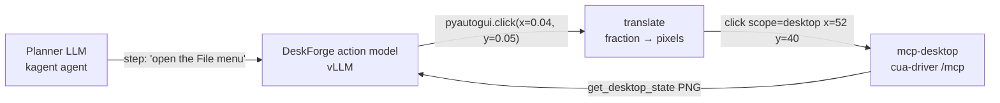

# DeskForge

[DeskForge](https://huggingface.co/collections/docling-project/deskforge) is a
controllable desktop environment for training computer-use agents, by ETH
Zurich, IBM Research Zurich and Microsoft (the Docling team). The collection
contains a dataset, two GUI grounding models fine-tuned on it, and a live demo.
This note covers what each part is and how it could be used with this sandbox.

Sources:

- [Paper (arXiv 2610.02320)](https://arxiv.org/abs/2610.02320)
- [Project page](https://saidgurbuz.github.io/deskforge/)
- [Code](https://github.com/Saidgurbuz/deskforge)

Figures below are from the model and dataset cards, as of 2026-10.

## What's in the collection

| Item | What it is | License |
| --- | --- | --- |
| [DeskForge-1M](https://huggingface.co/datasets/docling-project/DeskForge-1M) | 1.21M annotated desktop screenshots, 159.7M element instances, 917K recorded click transitions | MIT |
| [DeskForge-Qwen3.5-4B](https://huggingface.co/docling-project/DeskForge-Qwen3.5-4B) | Qwen3.5-4B fine-tuned for grounding and next-action prediction (v1.1; paper checkpoint at revision `v1.0`) | Apache 2.0 |
| [DeskForge-Gemma4-E4B](https://huggingface.co/docling-project/DeskForge-Gemma4-E4B) | Gemma 4 E4B (instruction-tuned) fine-tuned on 200K grounding examples | Apache 2.0 |
| [DeskForge Live](https://huggingface.co/spaces/docling-project/DeskForge) | Gradio Space on ZeroGPU: ground a screenshot, or race a fine-tuned model against its base on a shared desktop. Also an MCP server. | Apache 2.0 |

## Why it's relevant here

DeskForge screenshots are Linux X11 desktops: Xfce sessions with several real
applications per screen, overlapping windows, and Windows- and macOS-style
appearance presets. This sandbox is the same kind of screen (Xvfb, openbox,
Chromium), so the models are in-domain for it.

The models produce what cua-driver needs: given a screenshot and an
instruction, they return the next action with screen coordinates. They can act
as the *action model* under a planner, which is the setup the paper evaluates.

## The models

### Input and output

Each model takes three things: the fixed system prompt it was trained with, one
screenshot, and the task. It replies with exactly one action as a `pyautogui`
call. Coordinates are **fractions of the screen** (0.0–1.0, four decimals),
not pixels:

```text
pyautogui.click(x=0.0412, y=0.0535)
```

The action vocabulary is fixed by the system prompt:

- Pointer: `click`, `doubleClick`, `rightClick`, `middleClick`,
  `computer.tripleClick`, `moveTo`, `dragTo`.
- Scrolling: `scroll`, `hscroll`.
- Keyboard: `write`, `press`, `hotkey`.
- Control: `computer.wait()`, `computer.terminate(status=...)`.

Copy the system prompt verbatim from the
[model card](https://huggingface.co/docling-project/DeskForge-Qwen3.5-4B#usage).
Both models use the same prompt.

The user turn is formatted like this:

```text
Task: <instruction>

Actions already taken:
(none -- this is the first step)

Next action:
```

Inference settings used for training and evaluation:

- Thinking disabled (`enable_thinking=False`).
- Greedy decoding.
- At most 128 new tokens.
- Screenshots downscaled to at most 2,097,152 pixels. The sandbox's default
  1280×800 (1,024,000 px) needs no resizing.

### Serving

```sh
# Qwen
vllm serve docling-project/DeskForge-Qwen3.5-4B --max-model-len 16384
# Gemma
vllm serve docling-project/DeskForge-Gemma4-E4B --max-model-len 8192 \
  --mm-processor-kwargs '{"max_soft_tokens": 1120}'
```

Both serve an OpenAI-compatible API. Pass the screenshot as an `image_url`
data URL and `chat_template_kwargs: {"enable_thinking": false}`. The model
cards also show Transformers and offline vLLM usage. The Gemma card was tested
with transformers 5.16 and vLLM 0.28.

### Results (accuracy, %)

| Model | DeskForge held-out mean | ScreenSpot-Pro | ScreenSpot-v2 | OSWorld-G | UI-Vision | MMBench-GUI |
| --- | ---: | ---: | ---: | ---: | ---: | ---: |
| Qwen3.5-4B (base) | 76.26 | 30.17 | 80.11 | 51.24 | 17.24 | 61.83 |
| **DeskForge-Qwen3.5-4B v1.1** | **81.56** | **49.02** | **92.14** | **63.83** | **38.17** | **80.13** |
| Gemma4-E4B (base) | 12.27 | 1.83 | 46.86 | 10.64 | 3.28 | 31.39 |
| **DeskForge-Gemma4-E4B** | **85.12** | **21.95** | **79.56** | **44.15** | **13.87** | **58.90** |
| UI-Venus-2-9B (reference) | 78.92 | | | | | |

The "DeskForge held-out mean" column averages four test splits: new scenes, an
unseen theme, unseen apps and an unseen resolution.

The cards also report long-horizon task completion. A fixed Qwen3.6-27B
planner chooses each step, and only the action model changes:

| Action model | WebArena-Infinity (of 119) | OpenApps (of 100) |
| --- | ---: | ---: |
| Qwen3.5-4B → DeskForge (v1.0) | 31 → 50 | 3 → 15 |
| Gemma4-E4B → DeskForge | 5 → 40 | 2 → 12 |

In short, the Gemma model is better on DeskForge-style Linux desktops, and the
Qwen model is better on the external benchmarks.

## Using it with this sandbox

This is not implemented in this repository. The mapping below was checked
against the `mcp-desktop:cua` image (cua-driver 0.38.0), but the whole loop
hasn't been run.



1. Call `get_desktop_state`. It returns a PNG at full screen size (1280×800 by
   default) and the list of visible windows with their `pid` and `window_id`.
2. Send the PNG and the planner's step to the action model.
3. Multiply `x` by the screenshot width and `y` by its height.
4. Run the matching cua-driver tool. Pointer actions use `scope: "desktop"`,
   which takes screen-absolute pixels in the `get_desktop_state` frame without
   needing a `pid`:

| DeskForge action | cua-driver tool |
| --- | --- |
| `pyautogui.click(x, y)` | `click {scope: "desktop", x, y}` |
| `doubleClick` / `rightClick` / `middleClick` | `double_click`, or `click` with `button` / `count` |
| `dragTo` | `drag` |
| `scroll(n)` / `hscroll(n)` | `scroll {direction, amount}` |
| `write(message)` | `type_text` |
| `press(key)` / `hotkey([...])` | `press_key` / `hotkey` |
| `computer.wait()` / `terminate()` | Handled by the loop: re-capture the screen, or stop. |

Keyboard actions target a window. Take the `pid` from the `get_desktop_state`
window list.

If you request a smaller screenshot with `max_image_dimension`, cua-driver maps
coordinates read from it back to full size when you pass its `capture_id`.
Scale the fractions by the *returned* image size in that case.

There are two ways to run the action model:

- **Self-hosted (recommended).** Run `vllm serve` on a GPU node and put a small
  bridge in front of it. The bridge could be a `desktop-gw` extension or a
  separate MCP server exposing a `ground(instruction)` tool that does steps
  1–4. Screenshots then stay inside the cluster.
- **Hosted Space (demos only).** DeskForge Live serves MCP at
  `https://docling-project-deskforge.hf.space/gradio_api/mcp/` (Streamable
  HTTP). Its `DeskForge_ground` tool takes `instruction`, `screenshot` (an
  http(s) URL to an uploaded file), `max_new_tokens` and `family`
  (`Gemma4-E4B` or `Qwen3.5-4B`). It returns an annotated image, the action
  code, the fractional coordinates and the inference time. This sends
  screenshots to a public ZeroGPU Space with shared quota, so don't use it for
  real desktops.

## The dataset

The data is WebDataset shards, plus Parquet indexes under `index/`. Each
observation has four members:

| Member | Content |
| --- | --- |
| `png` | The screenshot. |
| `leaf.json` | Every visible element: type, role, name and text, `rect` and `visible_fragments`, state, hierarchy, owning app and window. |
| `screentag.txt` | The screen as [ScreenTag](https://github.com/Saidgurbuz/screenparse) markup on a 0–500 grid. |
| `record.json` | Scene metadata (apps, preset, resolution, window stack), eligibility flags, and the action that produced this state. |

Splits are per scene. Three test splits hold an attribute out of training
entirely:

| Split | Held out | Instructions |
| --- | --- | ---: |
| `train` | | 551,651 |
| `val` | | 6,281 |
| `test_id` | New scenes with seen attributes | 12,589 |
| `test_app` | GNOME System Monitor, Pluma, Xarchiver | 22,729 |
| `test_theme` | The Quartz Night Nord preset | 27,175 |
| `test_resolution` | 2880×1800 | 43,210 |

```python
from datasets import load_dataset

obs = load_dataset("docling-project/DeskForge-1M", split="test_app", streaming=True)
preview = load_dataset("docling-project/DeskForge-1M", "transitions_preview", split="val")
instr = load_dataset("parquet", split="train",
    data_files="hf://datasets/docling-project/DeskForge-1M/index/instructions/val.parquet")
```

- `index/transitions/<split>.parquet` joins each click to its before and after
  observations.
- `index/instructions/<split>.parquet` adds the natural-language instructions,
  joined on `transition_id`.

Use `state_train_eligible` for still-image training and
`transition_train_eligible` for action training.

The `test_*` splits could serve as a ready-made grounding benchmark for any
model driven through this sandbox.

## Limitations

- All screenshots come from one Linux (Xfce) backend. The Windows and macOS
  presets copy the look of those systems; they don't run them.
- Actions come from undirected click exploration, not goal-directed
  demonstrations. Instructions were written afterwards for single clicks.
- The models predict one step. Multi-step reliability depends on the planner
  around them.
- The model cards say the models are not safe autonomous agents: review their
  actions before running them on real systems. This sandbox's isolation (gVisor,
  loopback-only binds, no host access) is the right place to run them.

## Citation

```bibtex
@misc{gurbuz2026deskforge,
  title         = {DeskForge: Dense Supervision from Desktop Environments for Computer-Use Agents},
  author        = {A. Said Gurbuz and Ahmed Nassar and Sunghwan Hong and Marc Pollefeys and Peter W. J. Staar},
  year          = {2026},
  eprint        = {2610.02320},
  archivePrefix = {arXiv},
  primaryClass  = {cs.CV},
  url           = {https://arxiv.org/abs/2610.02320},
}
```
